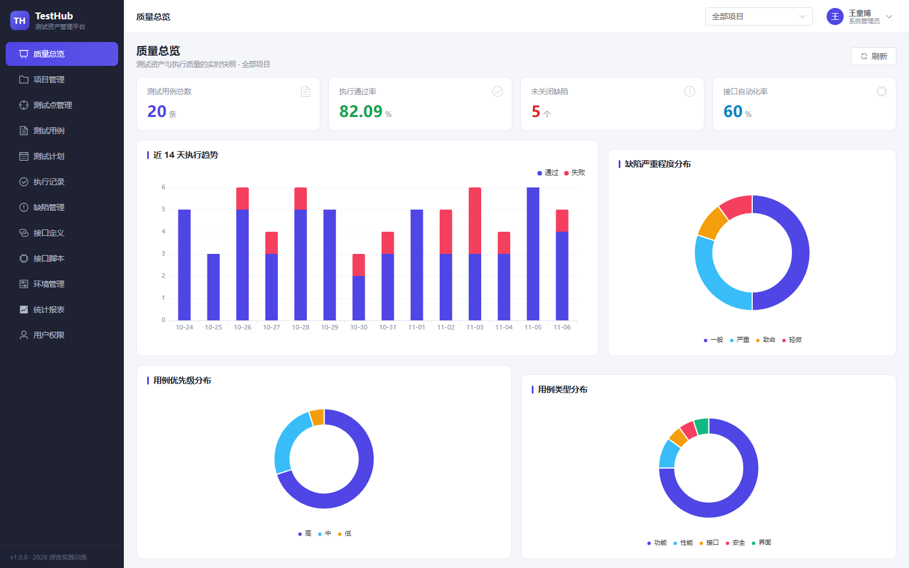
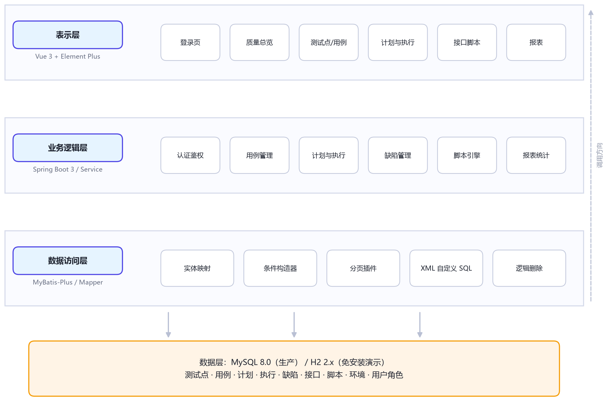
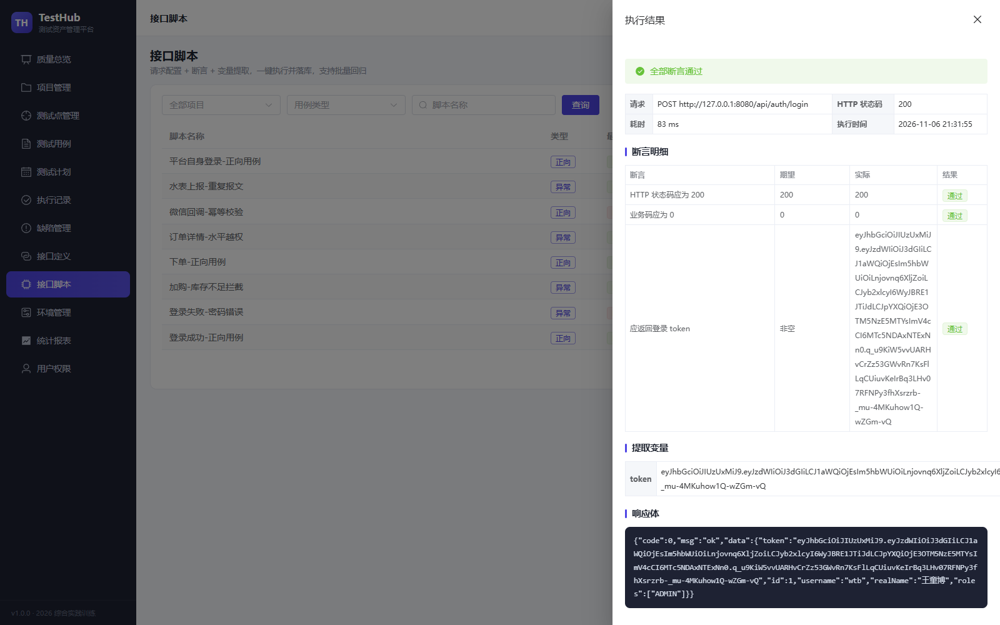

<div align="center">

# TestHub · 测试资产管理系统

**把测试点、用例、计划、执行、缺陷与接口脚本统一到一个平台**

Java 21 · Spring Boot 3.3 · MyBatis-Plus · Vue 3 · Element Plus


</div>



## 项目简介

TestHub 面向测试团队，解决测试资产分散在 Excel、Wiki 与 Postman 中导致的**覆盖不可追溯、执行与计划脱节、质量数据靠人工统计**等问题。

系统围绕「测试点 → 测试用例 → 测试计划 → 执行记录 → 缺陷」构建一条可追溯的链路，并内置一个**零代码的接口脚本执行引擎**（HTTP + JSONPath 断言 + 变量提取），让测试人员不写代码即可完成登录取 token、下单取单号这类接口依赖场景的回归。

## 功能矩阵

| 域 | 模块 | 关键能力 |
|---|---|---|
| 需求与用例 | 项目管理 | 多项目隔离，测试资产按项目归属 |
| | 测试点管理 | 按模块拆解需求，标注优先级 / 风险 / 来源，统计覆盖率 |
| | 测试用例 | 步骤化编排、关联测试点、复制、批量删除、状态流转 |
| 计划与执行 | 测试计划 | 批量加入用例、指派执行人、进度与通过率实时计算 |
| | 执行记录 | 逐条登记结果 / 实际现象 / 耗时，形成执行流水 |
| | 缺陷管理 | 由失败执行发起，状态机流转到关闭，严重程度分级 |
| 接口自动化 | 接口定义 | 方法、路径、请求头、请求体集中维护 |
| | 接口脚本 | JSON 描述请求 / 断言 / 变量，单条与批量执行 |
| | 执行日志 | 请求地址、状态码、耗时、响应体、失败原因全量留痕 |
| 平台支撑 | 环境管理 | 多环境 baseUrl 与公共变量 |
| | 质量报表 | 总览指标、执行趋势、用例分布、缺陷分布、模块覆盖、成员工作量 |
| | 用户权限 | RBAC 四角色（管理员 / 测试经理 / 测试工程师 / 开发工程师） |

## 技术架构



| 层次 | 技术选型 | 说明 |
|---|---|---|
| 后端 | JDK 21、Spring Boot 3.3.5 | Web、校验、AOP |
| 安全 | Spring Security 6 + JJWT | 无状态 JWT 认证 + 方法级 RBAC |
| 持久层 | MyBatis-Plus 3.5.7 | Lambda 条件构造器、分页插件、逻辑删除、审计字段自动填充 |
| 数据库 | MySQL 8.0 / H2 2.2 | 生产库与免安装演示库（同一份 DDL） |
| 前端 | Vue 3.5 + TypeScript + Vite 5 | 组合式 API、路由守卫、Pinia 状态管理 |
| UI | Element Plus 2.8 + ECharts 5 | 管理后台组件与统计图表 |
| 接口文档 | springdoc-openapi 2.6 | Swagger UI 在线调试 |
| 部署 | Docker Compose + Nginx | 前端静态资源与 API 反向代理 |

## 快速开始

### 方式一：免安装数据库（推荐，30 秒跑起来）

```bash
# 1. 启动后端（H2 内存库，自动建表并注入演示数据）
cd backend
mvn spring-boot:run            # 默认 --spring.profiles.active=h2

# 2. 启动前端
cd frontend
npm install && npm run dev     # http://127.0.0.1:5173
```

打开 <http://127.0.0.1:5173>，使用演示账号登录：

| 账号 | 密码 | 角色 |
|---|---|---|
| wtb | 123456 | 系统管理员 |
| zhangsan | 123456 | 测试经理 |
| lisi | 123456 | 测试工程师 |
| wangwu | 123456 | 开发工程师 |

### 方式二：MySQL + 生产构建

```bash
mysql -uroot -p < db/schema-mysql.sql
mysql -uroot -p < db/data-mysql.sql

cd backend
mvn clean package -DskipTests
java -jar target/testhub.jar --spring.profiles.active=mysql
```

```bash
cd frontend
npm install && npm run build   # 产物在 dist/，交由 Nginx 托管
```

### 方式三：Docker Compose

```bash
cd deploy
docker compose up -d --build
# 访问 http://localhost
```

## 接口与文档

后端启动后访问 **Swagger UI**：<http://127.0.0.1:8080/swagger-ui.html>

| 分组 | 前缀 | 说明 |
|---|---|---|
| 认证 | `/api/auth` | 登录、当前用户、退出 |
| 用户与角色 | `/api/users` | 分页、增删改、重置密码 |
| 项目 | `/api/projects` | 分页、下拉选项 |
| 测试点 | `/api/test-points` | 分页、模块枚举 |
| 测试用例 | `/api/test-cases` | 分页、复制、批量删除 |
| 测试计划 | `/api/test-plans` | 计划用例编排、进度统计 |
| 测试执行 | `/api/executions` | 登记执行结果 |
| 缺陷 | `/api/defects` | 提交、状态流转 |
| 接口定义 | `/api/apis` | 接口清单 |
| 接口脚本 | `/api/api-scripts` | 脚本 CRUD、执行、批量执行、执行日志 |
| 环境 | `/api/environments` | 多环境管理 |
| 报表 | `/api/report` | 总览、趋势、分布、覆盖、工作量 |

统一响应结构：

```json
{ "code": 0, "msg": "ok", "data": {} }
```

## 接口脚本引擎

一条脚本由三段 JSON 描述，执行时按「变量替换 → 发送请求 → 断言校验 → 变量提取 → 落库日志」处理：

```json
{
  "requestConfig": {
    "method": "POST",
    "path": "/api/auth/login",
    "headers": { "Content-Type": "application/json" },
    "body": { "username": "wtb", "password": "123456" }
  },
  "assertions": [
    { "type": "STATUS_CODE", "expected": "200", "operator": "EQ", "message": "HTTP 200" },
    { "type": "JSON_PATH", "expression": "$.code", "operator": "EQ", "expected": "0", "message": "业务码为 0" },
    { "type": "JSON_PATH", "expression": "$.data.token", "operator": "NOT_EMPTY", "message": "返回 token" }
  ],
  "extractors": [
    { "name": "token", "type": "JSON_PATH", "expression": "$.data.token", "scope": "GLOBAL" }
  ]
}
```

- 断言类型：`STATUS_CODE`、`JSON_PATH`、`RESPONSE_TIME`、`BODY_CONTAINS`
- 运算符：`EQ`、`NEQ`、`CONTAINS`、`NOT_EMPTY`、`GT`、`LT`
- 变量：`{{var}}` 占位符从「全局变量池 + 脚本变量 + 环境变量」合并解析，提取结果写回全局池，供后续脚本复用



## 目录结构

```
testhub/
├── backend/                  # Spring Boot 后端
│   ├── src/main/java/com/testhub/
│   │   ├── common/           # 统一响应、分页、异常处理
│   │   ├── config/           # MyBatis-Plus、CORS、OpenAPI、Jackson 配置
│   │   ├── security/         # JWT、认证过滤器、安全配置
│   │   ├── system/           # 用户与角色
│   │   ├── project/          # 项目
│   │   ├── testpoint/        # 测试点
│   │   ├── testcase/         # 测试用例
│   │   ├── testplan/         # 计划、执行
│   │   ├── defect/           # 缺陷
│   │   ├── api/              # 接口定义、脚本、环境、执行引擎
│   │   └── report/           # 质量报表
│   └── src/main/resources/
│       ├── db/h2/            # 演示建表与种子数据
│       └── mapper/           # 自定义 SQL
├── frontend/                 # Vue 3 前端
│   └── src/
│       ├── api/              # 请求封装与接口定义
│       ├── layout/           # 侧边栏与顶栏布局
│       ├── router/           # 路由与登录守卫
│       ├── stores/           # Pinia 状态
│       └── views/            # 13 个页面
├── db/                       # MySQL 建表与演示数据
├── deploy/                   # Docker Compose 与 Nginx 配置
├── docs/                     # 设计文档、课程报告、界面截图
└── .github/workflows/        # GitHub Actions 持续集成
```

## 质量数据（演示环境）

| 指标 | 数值 |
|---|---|
| 测试点 | 16 |
| 测试用例 | 20（自动化标记 12） |
| 测试计划 | 3 |
| 执行记录 | 72，执行通过率 **82.09%** |
| 缺陷 | 10（未关闭 5） |
| 接口定义 / 脚本 | 11 / 8 |
| 数据库表 | 14 |

## 测试

```bash
cd backend
mvn test
```

- `ApiRunnerVariableTest`：变量替换的边界场景（未定义变量保留、`$` 与反斜杠转义、重复占位符）
- `AuthIntegrationTest`：登录成功、密码错误、未带令牌访问受保护接口返回 401

## 简历可用的项目描述

> **TestHub 测试资产管理系统**（个人独立完成 · Java 全栈）
> - 基于 Spring Boot 3 + Vue 3 实现测试资产全生命周期管理，抽象「测试点—用例—计划—执行—缺陷」追溯链路，覆盖 12 个功能模块、14 张数据表；
> - 设计并实现零代码接口自动化引擎：以 JSON 描述请求 / 断言 / 变量提取，支持 JSONPath 断言、响应变量提取与跨脚本传参，解决登录 token、订单号等接口依赖场景的回归问题；
> - 使用 Spring Security + JWT 实现 RBAC 四角色权限，MyBatis-Plus 完成分页与逻辑删除，并用 Spring Boot Test + MockMvc 编写认证与越权场景的自动化测试；
> - 通过质量报表将覆盖率、通过率、缺陷分布等指标自动聚合，替代人工统计，单轮回归由 3 小时缩短到分钟级。

## 文档

| 文档 | 说明 |
|---|---|
| [docs/数据库设计.md](docs/数据库设计.md) | 14 张表的数据字典与核心链路 |
| [docs/接口说明.md](docs/接口说明.md) | 接口清单与关键请求示例 |
| [docs/部署说明.md](docs/部署说明.md) | 三种部署方式与环境变量 |
| [docs/课程报告](docs/王童博-综合实践训练报告.docx) | 《综合实践训练》课程报告（含 38 页排版文档） |
| [docs/学习笔记](docs/王童博-综合实践训练学习笔记.docx) | 四阶段学习笔记 |

## License

[MIT](LICENSE)
